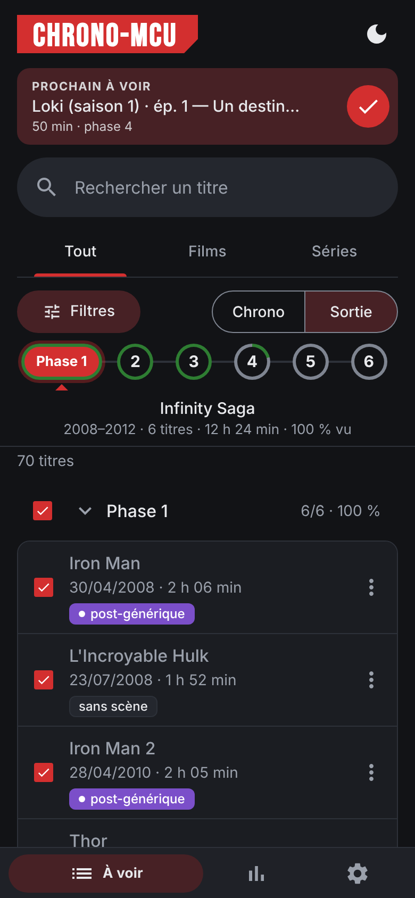
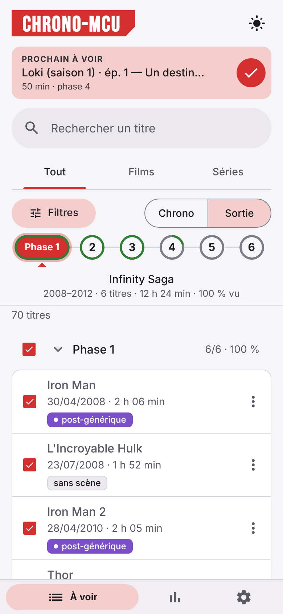
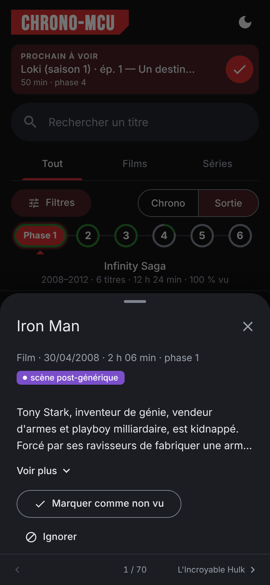
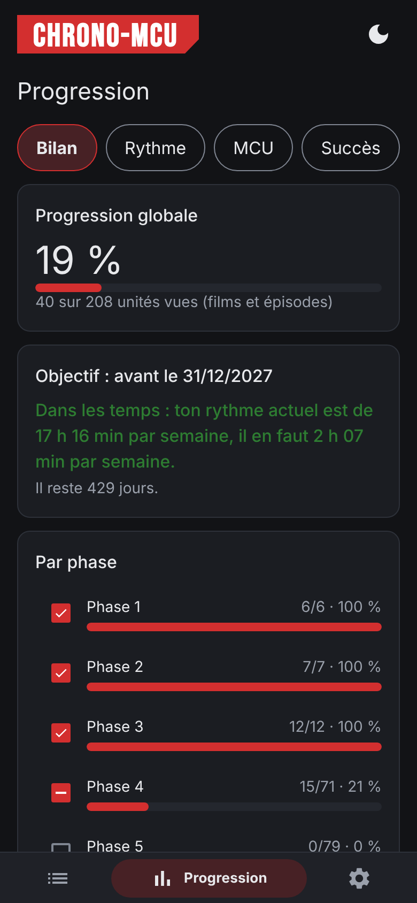
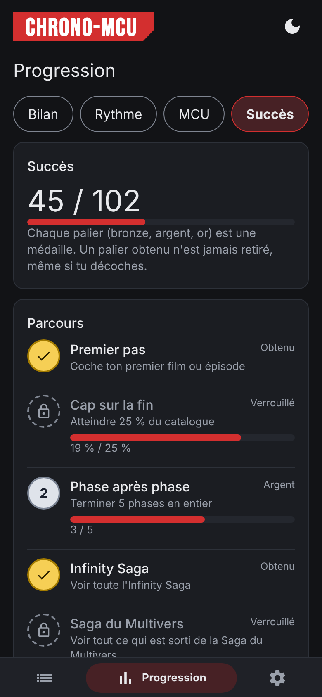

# Chrono-MCU

Suivi de visionnage du MCU (films et séries Disney+), façon Chronogeek. Application web statique : pas de compte, pas de serveur. Ta progression reste dans ton navigateur (`localStorage`).

## Captures d'écran

| À voir (sombre) | À voir (clair) | Fiche d'un titre | Progression | Succès |
|---|---|---|---|---|
|  |  |  |  |  |

Données de démonstration (progression fictive, sans affiches). Pour les régénérer : `npm run screenshots`.

## Fonctions

L'interface suit Material 3 : une barre de navigation compacte en bas sur téléphone (48 px, nom visible seulement sur la page active ; rail latéral dès 600 px), et dès 840 px un panneau de détail fixe à droite de la liste.

- **À voir** : onglets Tout / Films / Séries, recherche (titres de films et séries, sans accents ; les titres d'épisodes sur option), bouton « Filtres » (statut, personnage ou équipe, afficher/masquer les ignorés, scène après le générique, durée, chercher dans les épisodes, grouper par phase proposé seulement en ordre de sortie), barre des phases (en ordre de sortie seulement, car en ordre chronologique les phases se mélangent ; frise de six ronds reliés (anneau vert = part vue ; la phase courante devient une pastille rouge « Phase N » avec une petite flèche vers la phrase) : un appui fait défiler la liste jusqu'à la phase sans rien masquer, et l'onglet suit les titres visibles quand tu défiles ; dessous, la saga et les chiffres de la phase (années, titres, durée, % vu) ; elle reste collée sous le titre, sauf sur un écran de moins de 560 px de haut), ordre chronologique ou de sortie. En haut, « Prochain à voir » (bandeau fin) : le titre (ou l'épisode) qui suit **le dernier que tu as coché** dans l'ordre choisi. Un appui sur le bandeau retire la recherche et l'onglet qui cacheraient la ligne, y défile, ouvre la fiche (pour un épisode, la fiche défile jusqu'à lui et le surligne) ; le rond à droite coche sans ouvrir. Ce que tu as sauté avant n'est jamais rappelé ; sans historique, il propose le tout premier titre.
- **Fiche d'un titre** (bottom sheet sur téléphone, panneau à droite sur grand écran) : détails, scènes après le générique, résumé, bouton « Ignorer », et pour une série la liste des épisodes à cocher. Les épisodes dont la date de diffusion (américaine, le jour même) n'est pas encore arrivée sont exclus des totaux et du « Prochain à voir », et affichés « Sort le JJ/MM/AAAA » dans la fiche. Le bouton « ⋮ » d'une ligne ouvre un menu d'actions, dont « Tout marquer vu jusqu'ici » (rattrapage d'historique en un geste, annulable ; ces unités comptent dans les heures vues mais pas dans le rythme). Sur écran tactile, glisser une ligne vers la droite la marque vue (non vue si elle l'est déjà), vers la gauche l'ignore (réactive si elle est ignorée) ; le geste se valide au-delà de 40 % de la largeur et reste annulable. Dans la fiche, glisser un épisode vers la droite le marque vu. Pour passer d'une fiche à l'autre : glisser l'en-tête (image paysage, titre, résumé) vers la gauche (suivant) ou la droite (précédent), appuyer sur le pied de fiche « ‹ titre précédent · n / N · titre suivant › » (épinglé en bas, noms des voisins masqués sous 360 px), ou utiliser les flèches ← → du clavier. Les fiches se feuillettent dans l'ordre de la liste affichée (filtres et recherche compris, phases repliées exclues) ; aux deux bouts, la fiche rebondit.
- Cocher un film, un épisode, une série entière ou une phase entière ; chaque coche propose « Annuler » pendant 10 secondes.
- **Hors-ligne** : après une première visite, l'application s'ouvre et se coche sans réseau (service worker `sw.js`, cache renouvelé à chaque déploiement ; la page d'accueil passe par le réseau d'abord, donc une mise à jour apparaît dès que tu es en ligne). Les affiches TMDB ne sont pas conservées hors ligne. Elle s'installe sur l'écran d'accueil du téléphone via le menu du navigateur.
- **Accueil** : au premier lancement (rien de coché), une feuille explique les gestes et propose de commencer de zéro ou de rattraper l'historique (ordre, puis dernier titre vu : tout ce qui précède est marqué en rattrapage). Elle ne revient pas ; « Revoir l'accueil » est dans Réglages > À propos.
- **Annulation et retour tactile** : la snackbar annule la dernière action ; Réglages > Données annule les 20 dernières, une à une, jusqu'au rechargement. À la coche, le rond rebondit et l'appareil vibre un instant (réglage « Retour tactile » ; animations coupées si ton système les réduit).
- **Progression** (quatre sous-onglets) : **Bilan** (pourcentage global, barre par phase (avec case pour cocher la phase), heures vues et restantes, rythme et date de fin estimée après 2 jours d'usage) ; **Rythme** (série de jours, titres par semaine, histogramme des 12 dernières semaines, calendrier d'activité de 18 semaines, jalons 25/50/75/100 %) ; **MCU** (records, scènes post-générique, temps vu par phase, saga et format, frise des sorties) ; **Succès** (médailles bronze/argent/or : progression, heures de vol, sauvegardes, séries de jours et de semaines, marathons, suites vues dans l'ordre, phases express, séries et films terminés, scènes post-générique, records de durée, un « Tout sur… » par personnage ou équipe, et 8 succès cachés). Un bandeau annonce chaque déblocage, avec un bouton « Voir ». Un palier obtenu n'est jamais retiré. Tout est calculé sur ton appareil depuis les dates de coche ; les rattrapages ne comptent pas dans le rythme.
- **Objectif** : une date cible (Doomsday, le 18/12/2026, par défaut ; modifiable ou retirable dans Réglages) ; l'écran Progression dit combien d'heures regarder par semaine pour tout voir à temps, et si ton rythme actuel suffit.
- **Mode sans spoiler** (Réglages > Apparence) : tant que tu n'as pas commencé un titre, son résumé et l'image de sa fiche sont floutés et le titre d'un épisode reste flou tant que l'épisode n'est pas vu ; un bouton « Afficher les spoilers » les révèle dans la fiche, et « Masquer les spoilers » les re-floute. Dans « Prochain à voir », le titre de l'épisode est remplacé par son numéro. Le résumé d'une fiche tient sur 3 lignes, avec « Voir plus » seulement s'il est plus long.
- **Données** (Réglages) : rappel de sauvegarde réglable (7, 14, 30 jours ou jamais) et « Effacer toute ma progression » (une sauvegarde est téléchargée d'abord, l'effacement est annulable 10 secondes).
- **Thème** : un bouton en haut à droite, visible sur tous les écrans, fait défiler Auto, Clair et Sombre.
- **Réglages** (sections repliables, une seule ouverte à la fois) : « Ce que je suis » (couper en bloc les séries, les courts formats, les autres réalités ou la saga du Multivers, avec le poids de chaque catégorie ; un titre précis se réintègre depuis son menu), thème Auto (suit le système), Clair ou Sombre, plus un interrupteur « Noir OLED » (noir pur) qui s'applique au mode sombre, y compris quand le thème est en Auto ; affiches, sauvegarde et restauration (export / import JSON), sources et version.
- Durées affichées au même format partout : « 45 min », « 2 h 06 min », et au-delà de 24 h « 15 j 21 h 12 min » (les données sont en minutes).
- Couleurs : une seule valeur par couleur, identique dans les thèmes Clair, Sombre et OLED : rouge `#d32f2f` (celui de l'icône), vert `#2e7d32`, ambre `#a85f00`, bleu `#1e6fd9`, violet `#7b4fc9`, plus un gris `#5f6368`, avec du texte blanc dessus (contraste AA). Le texte courant reste en couleur normale ; les liens sont soulignés de rouge. Les médailles de succès gardent leurs couleurs bronze, argent et or.
- Badges (pastilles pleines à texte blanc) : « ignoré » (gris), « à venir » (bleu), scène post-générique (violet), « version » et « à vérifier » (ambre), « autre réalité » (vert) (What If, Marvel Zombies, Your Friendly Neighborhood Spider-Man), scènes mi-générique / post-générique par film (recoupées avec la [liste Wikipedia des scènes du MCU](https://en.wikipedia.org/wiki/Mid-credits_and_post-credits_scenes_in_the_Marvel_Cinematic_Universe)).
- Accessibilité : cibles tactiles de 48 px, contrastes WCAG AA dans les trois thèmes, navigation au clavier, feuilles modales natives (focus piégé, Échap), texte qui suit la taille choisie dans le système, `prefers-reduced-motion` respecté.

## Lancer en local

```
python3 -m http.server 8000   # puis http://localhost:8000
npm test                      # tests unitaires (Node 22+)
npm run validate              # vérifie data/mcu.json
npm run icons                 # régénère les icônes PNG depuis icons/icon.svg
npm run screenshots           # régénère les captures du README (docs/screenshots)
npm install && npx playwright install --only-shell chromium && npm run e2e   # accessibilité (axe-core), cibles tactiles, clavier, puis parcours de comportement
```

Le test `npm run e2e` (dépendances de développement seulement : `axe-core` et `playwright`) parcourt chaque écran et chaque feuille dans les 3 thèmes et 3 largeurs d'écran ; il tourne aussi dans la CI et bloque le déploiement en cas de régression.

## Corriger ou compléter les données

Tout le catalogue est dans `data/mcu.json` (phases 1 à 6, jusqu'à Avengers : Secret Wars). Chaque entrée a un champ `verified` : `true` quand dates, titres et durées sont recoupés avec des sources (TheTVDB, Apple TV, presse), `false` quand une partie reste estimée (durées d'épisodes approximatives, titres d'épisodes génériques « Épisode n », séries en cours). Un badge « à vérifier » s'affiche dans l'app.

L'ordre chronologique suit la frise publiée par le jeu de données ouvert [Marvel Archive](https://github.com/les2/marvel-screen-archive) (`timelineOrder`, métadonnées sous licence CC BY 4.0), complété à la main pour les titres qu'il ne place pas (Loki 2, What If 2 et 3, Eyes of Wakanda, Marvel Zombies, titres 2025-2026). Ce n'est pas une copie vérifiée de l'ordre affiché sur Disney+ : corrige `chronoOrder` si le tien diffère. Les titres d'épisodes de Daredevil, What If, Loki 2 et WandaVision ont été recoupés avec le catalogue [mcu-completionist-watchlist](https://github.com/CinematicArchivesHQ/mcu-completionist-watchlist).

Les durées d'épisodes viennent de [TVmaze](https://www.tvmaze.com) (une seule source, donc cohérente, mais elles peuvent différer de quelques minutes de ce qu'affiche Disney+ selon que le générique est compté), et celles des films de l'infobox de Wikipedia. Seule VisionQuest reste « à vérifier » : quatre de ses épisodes ne sont pas encore sortis et leurs durées viennent de fuites.

Un film peut avoir des `versions` (ressortie avec des scènes en plus) : `{ id, label, badge, note, releaseDate, runtimeMin, postCredits? }`. Le film garde une seule case ; la fiche propose « Version regardée » (Originale par défaut) et la durée comptée et les scènes post-générique suivent le choix, enregistré dans l'état (`versions`, champ optionnel, présent dans l'export). Exemple : Endgame Encore.

Les titres pas encore sortis portent `"upcoming": true` (sans `runtimeMin` ni `episodes`). Ils s'affichent « à venir » (cadre pointillé) et ne comptent pas dans la progression ; ils peuvent s'ignorer (menu ⋮, fiche ou glissement vers la gauche) et le restent à leur sortie. À leur sortie : retirer `upcoming`, ajouter durée ou épisodes.

Pour corriger : éditer l'entrée, passer `verified` à `true`, puis lancer `npm run validate`. Règles :

- `id` unique et stable (la progression est stockée avec cet id : le changer perd les coches) ;
- `chronoOrder` unique par titre ;
- `altUniverse` : `true` pour un titre situé dans une autre réalité (absent sinon) ;
- `postCredits` (films) : tableau de `"mid"` / `"end"` ; `[]` = aucune scène après le générique ; champ absent = inconnu (aucun badge) ;
- `tvmazeId` (séries) : identifiant TVmaze pour le contrôle des durées ;
- film : `runtimeMin` obligatoire ; série : `episodes` (`n` de 1 à N, `title`, `runtimeMin`).

Les sorties annoncées après octobre 2026 ne sont pas listées : à ajouter à la main.

## Synchronisation automatique du catalogue

Le workflow `.github/workflows/catalog-sync.yml` tourne le 1er de chaque mois, et à la demande (onglet Actions > Synchronisation du catalogue > Run workflow) et lance `node scripts/sync-catalog.mjs --write`. Il prépare une pull request en brouillon, à relire ; rien n'est fusionné tout seul :

- un titre « à venir » dont la date est passée devient un titre sorti : durée et date France du film (TMDB), épisodes et durées de la série (TVmaze). Il reste « à vérifier » tant que tout n'est pas recoupé ;
- une annonce ou sortie Marvel Studios / Marvel Animation absente du catalogue est ajoutée comme brouillon « à venir » (phase la plus récente, ordre chronologique en dernier), avec affiche et résumé. Sont ignorés : documentaires, « making of », titres « Untitled », sorties à plus de 18 mois ou vieilles de plus de 60 jours ;
- une nouvelle saison d'une série suivie est seulement signalée dans le rapport : son ajout, comme l'ordre chronologique, les scènes post-générique (`postCredits`) et les personnages (`heroes`), reste manuel ;
- pour ne plus voir un titre proposé, ajouter son identifiant TMDB dans `data/sync-ignore.json` : `{ "tmdbIds": [123] }`.

Depuis l'application, Réglages > Données > Catalogue propose un lien vers la page GitHub du workflow (« Run workflow »). Avec un jeton personnel GitHub « fine-grained », limité à ce dépôt et au seul droit « Actions : lecture et écriture », collé dans la même section, l'application lance elle-même la synchronisation et suit son avancement (lien vers le journal à la fin). Le jeton reste dans ce navigateur, sous une clé à part : il n'est jamais exporté avec ta progression, et « Retirer le jeton » l'efface. La CSP autorise pour cela `api.github.com`.

La partie TMDB demande un secret de dépôt `TMDB_API_KEY` (Settings > Secrets and variables > Actions) ; sans lui, seul TVmaze est interrogé. Pour que le workflow ouvre la pull request, activer « Allow GitHub Actions to create and approve pull requests » (Settings > Actions > General) ; sinon il laisse la branche et ouvre une issue. Une PR ouverte par GitHub Actions ne lance pas la CI : les tests tournent à la fusion, avant le déploiement. En local : `NODE_USE_ENV_PROXY=1 TMDB_API_KEY=… node scripts/sync-catalog.mjs` affiche le rapport sans rien écrire.

## Contrôle automatique des durées

Chaque série porte un `tvmazeId`. `node scripts/check-data.mjs` compare les durées et le nombre d'épisodes de `data/mcu.json` à TVmaze et sort en erreur s'il y a un écart ; avec `--write`, il met à jour les durées et passe `verified` à `true` quand tous les épisodes ont une durée TVmaze. Le workflow `.github/workflows/data-check.yml` le lance le 1er de chaque mois (et à la demande dans l'onglet Actions) : un échec est signalé par GitHub. Il ne tourne pas sur les PR, pour qu'une panne de TVmaze ne bloque pas un merge.

## Installer sur l'écran d'accueil

Chrono-MCU est une application web installable (PWA) : sur Android (Chrome), menu ⋮ > « Installer l'application » ; sur iPhone (Safari), Partager > « Sur l'écran d'accueil » ; sur ordinateur (Chrome, Edge), icône d'installation dans la barre d'adresse. L'icône est le monogramme « CM » blanc sur rouge, dans la police du titre (source : `icons/icon.svg`, PNG générés par `npm run icons`). Un téléphone garde l'icône de l'installation : après un changement d'icône, désinstalle puis réinstalle l'application pour voir la nouvelle.

## Titre et police
Le titre « Chrono-MCU » s'affiche en capitales condensées blanches sur un bloc rouge au coin chanfreiné, dans l'esprit d'un logo de franchise (un style, pas le logo Marvel ; l'application n'est pas officielle). La police est [Bebas Neue](https://github.com/dharmatype/Bebas-Neue) de Dharma Type (SIL Open Font License, texte dans `fonts/OFL.txt`), réduite aux caractères utiles et servie depuis le site (`fonts/bebas-neue-subset.woff2`, autorisée par la CSP `font-src 'self'`).

## Affiches

Le champ optionnel `poster` (chemin TMDB, ex. `/abc123.jpg`) ajoute une affiche à chaque titre ; `tmdbId` garde l'identifiant TMDB. Sans affiche, l'app s'affiche comme avant (la case « Afficher les affiches » et la mention TMDB n'apparaissent que s'il y en a). Une image qui ne charge pas disparaît sans casser la ligne.

Pour remplir les affiches (clé API v3 gratuite sur themoviedb.org, réseau ouvert vers `api.themoviedb.org`) :

```
TMDB_API_KEY=ta_clé node scripts/fetch-posters.mjs          # ajoute les affiches manquantes
TMDB_API_KEY=ta_clé node scripts/fetch-posters.mjs --dry    # essai à blanc
TMDB_API_KEY=ta_clé node scripts/fetch-posters.mjs --force  # refait toutes les affiches
TMDB_API_KEY=ta_clé node scripts/fetch-posters.mjs --details # ajoute images paysage, dates de sortie France des films, résumés et titres d'épisodes en français (`titleFr`)
```

Derrière un proxy d'entreprise ou de session cloud, ajoute `NODE_USE_ENV_PROXY=1` (Node 22.21+) devant la commande.

`backdrop` (image paysage TMDB) alimente l'en-tête des fiches en feuille ; `releaseDateFr` (films) est la sortie salle en France, affichée à la place de `releaseDate` (sortie d'origine, qui sert au tri « Sortie ») ; chaque épisode porte un `airDate` (date de diffusion d'origine, TVmaze), rempli et contrôlé par `node scripts/check-data.mjs --write`. Les saisons (« Loki (saison 2) ») prennent l'affiche de la saison quand TMDB en a une. Le script préfère le titre exact et écarte les making-of et podcasts, mais relis le résultat : une recherche par titre peut encore se tromper, corrige `poster` et `tmdbId` à la main si besoin. Les affiches restent la propriété de leurs ayants droit ; elles sont chargées depuis TMDB, jamais copiées dans le dépôt.

## Déploiement

GitHub Pages impose un cache navigateur de 10 minutes sur tous les fichiers. Pour que chaque déploiement soit vu tout de suite, le workflow remplace le marqueur `__BUILD__` (présent dans `index.html`, `js/app.js` et `js/store.js`) par l'identifiant du commit : les fichiers sont alors demandés avec `?v=<commit>`. La version déployée s'affiche en bas de la page. En local, le marqueur reste tel quel et la page indique « Version locale ».

Le workflow `.github/workflows/pages.yml` lance les tests, puis déploie sur GitHub Pages à chaque push sur `main`. À activer une fois dans Settings > Pages > Source : GitHub Actions.

## Spécification et plan

Voir `SPEC.md` et `tasks/`.
