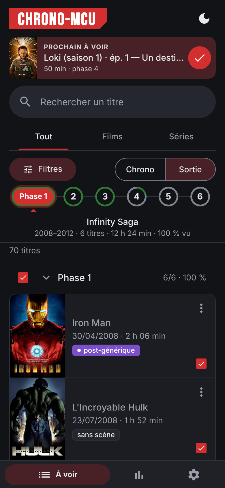
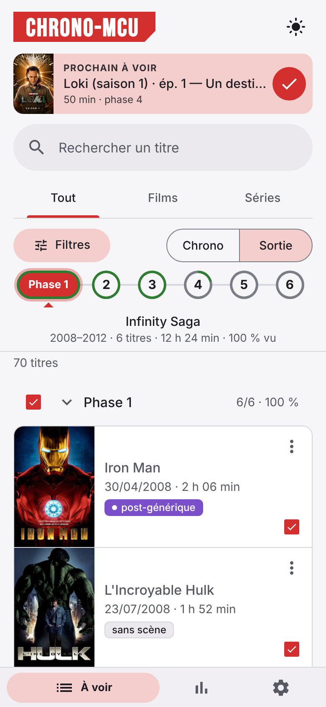
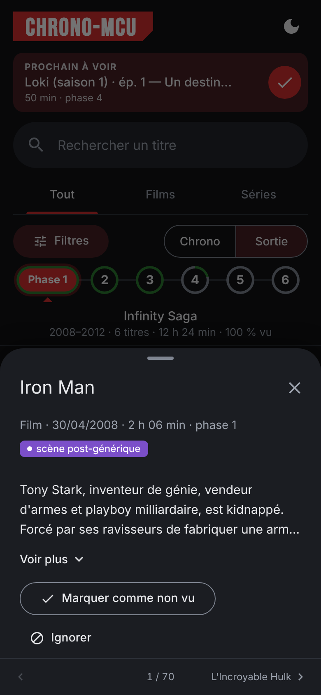
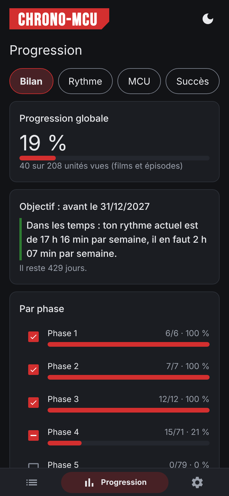
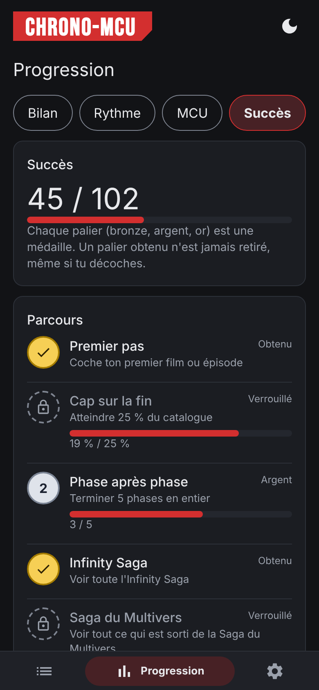

# Chrono-MCU

Suivi de visionnage du MCU (films et séries Disney+), façon Chronogeek. Application web statique : ni compte, ni serveur. La progression reste dans le navigateur (`localStorage`) et se sauvegarde par export JSON.

**Sommaire** : [Captures](#captures-décran) · [Fonctions](#fonctions) · [Limites connues](#limites-connues) · [Lancer en local](#lancer-en-local) · [Données](#données) · [Installer et déployer](#installer-et-déployer) · [Pour aller plus loin](#pour-aller-plus-loin)

## Captures d'écran

| À voir (sombre) | À voir (clair) | Fiche d'un titre | Progression | Succès |
|---|---|---|---|---|
|  |  |  |  |  |

Données de démonstration (progression fictive). Affiches © leurs ayants droit, fournies par [TMDB](https://www.themoviedb.org) (ce produit utilise l'API TMDB sans être approuvé ni certifié par TMDB). Régénération : `npm run screenshots` (réseau nécessaire pour les affiches).

## Fonctions

Interface Material 3 : barre de navigation en bas sur téléphone, rail latéral dès 600 px, panneau de détail fixe à droite de la liste dès 840 px. Le logo « Chrono-MCU » remonte en haut de la liste (et y ramène depuis un autre écran) sans toucher à la recherche ni aux filtres.

**À voir**
- Onglets Tout / Films / Séries, recherche sans accents, filtres (statut, personnage ou équipe, ignorés, scène après le générique, durée).
- Ordre chronologique ou de sortie. En ordre de sortie : barre des phases (frise de six ronds, anneau vert = part vue, saga et chiffres de la phase dessous) et regroupement par phase.
- « Prochain à voir » : le titre ou l'épisode qui suit le dernier coché ; un appui ouvre la fiche, le rond à droite coche sans ouvrir. Ce qui a été sauté avant n'est jamais rappelé.
- Cocher un film, un épisode, une série ou une phase entière ; chaque coche est annulable pendant 10 secondes.

**Fiche d'un titre** (feuille sur téléphone, panneau sur grand écran)
- Détails, scènes après le générique, résumé, bouton « Ignorer », épisodes à cocher. Les épisodes pas encore diffusés sont exclus des totaux.
- Rattrapage d'historique en un geste (« Tout marquer vu jusqu'ici ») : compte dans les heures vues, pas dans le rythme.
- Gestes tactiles : glisser une ligne vers la droite = vu, vers la gauche = ignorer. D'une fiche à l'autre : glisser l'en-tête, pied de fiche « ‹ précédent · n / N · suivant › », ou flèches ← → du clavier.

**Progression** (quatre sous-onglets)
- **Bilan** : pourcentage global, barre par phase, heures vues et restantes, rythme et date de fin estimée.
- **Rythme** : série de jours, titres par semaine, histogramme, calendrier d'activité, jalons.
- **MCU** : records, scènes post-générique, temps vu par phase, saga et format, frise des sorties.
- **Succès** : plus de 80 succès à médailles bronze, argent et or (progression, rythme, MCU, un « Tout sur… » par personnage ou équipe, 17 succès cachés). Détail par couleur, bloc « Bientôt » (les plus proches), filtres Tous / En cours / Obtenus / Verrouillés. Un palier obtenu n'est jamais retiré ; les rattrapages ne comptent pas dans le rythme.
- **Annonces** : un bandeau avec la médaille du palier ; une feuille de célébration pour un grand succès (dernier palier, saga, objectif, tout voir).
- **Objectif** : une date cible (Doomsday, le 18/12/2026, par défaut) ; Progression indique les heures à regarder par semaine et si le rythme actuel suffit.

**Réglages** (sections repliables)
- **Ce que je suis** : couper en bloc les séries, les courts formats, les autres réalités ou une saga ; un titre précis se réintègre depuis son menu.
- **Apparence** : thème Auto / Clair / Sombre (aussi par le bouton en haut à droite), noir OLED, affiches, mode sans spoiler (résumé, image et titres d'épisodes floutés jusqu'au début du titre), succès cachés masqués ou non, retour tactile.
- **Données** : sauvegarde et restauration (export / import JSON : progression, thème, objectif, mode sans spoiler, succès), rappel de sauvegarde, annulation des 20 dernières actions, synchronisation du catalogue, réinitialisation des succès, effacement de la progression (sauvegarde téléchargée d'abord).

**Fiabilité**
- **Hors-ligne** : après une première visite, l'application s'ouvre et se coche sans réseau (service worker) ; un bandeau propose de recharger quand une nouvelle version est prête.
- **Pannes visibles** : un message en français remplace l'écran blanc (script introuvable, catalogue indisponible, JavaScript désactivé, erreur inattendue).
- **Données illisibles** : l'état enregistré est réparé quand c'est possible, une copie brute est gardée à part, un bandeau le signale et propose de la télécharger.
- **Accessibilité** : cibles tactiles de 44 px au minimum, contrastes WCAG AA dans les trois thèmes, mode contraste élevé de Windows, navigation au clavier, `prefers-reduced-motion` respecté.

Le détail des gestes, des couleurs, des badges et des règles est dans [`SPEC.md`](SPEC.md#annexe--référence-détaillée-ex-readme).

## Limites connues

- Aucun compte, aucune synchronisation entre appareils : le transfert passe par l'export / import JSON.
- La progression vit dans le navigateur, qui peut effacer les données du site : exporter régulièrement.
- Le rythme et les succès se calculent par jour de coche, pas à l'heure près.
- Le catalogue est tenu à la main, avec une synchronisation mensuelle à relire. Les durées d'épisodes (TVmaze) et de films (Wikipedia) peuvent différer de quelques minutes de Disney+.
- L'ordre chronologique n'est pas une copie vérifiée de celui de Disney+ ; `chronoOrder` se corrige dans les données.
- Les affiches viennent de TMDB (l'adresse IP du visiteur lui est donc visible) ; elles se coupent dans Réglages.
- Application non officielle, sans lien avec Marvel, Disney ou leurs ayants droit.

## Lancer en local

```
python3 -m http.server 8000   # puis http://localhost:8000
npm test                      # tests unitaires (Node 22+)
npm run validate              # vérifie data/mcu.json et data/sagas.json
npm run icons                 # régénère les icônes PNG depuis icons/icon.svg
npm run screenshots           # régénère les captures du README
npm install && npx playwright install --only-shell chromium && npm run e2e
```

`npm run e2e` (dépendances de développement : `axe-core`, `playwright`) parcourt chaque écran et chaque feuille dans 3 thèmes et 3 largeurs : accessibilité (axe), cibles tactiles, clavier, puis les parcours de comportement. Il tourne aussi dans la CI, et `main` est protégée : une PR doit passer les contrôles `test` et `e2e`.

## Données

- **Catalogue** : `data/mcu.json` (phases 1 à 6, jusqu'à Avengers : Secret Wars). Chaque entrée a un champ `verified` : `true` quand dates, titres et durées sont recoupés, `false` sinon (badge « à vérifier »).
- **Sagas** : `data/sagas.json` (`{ "id", "name" }`) ; le champ `saga` de chaque titre doit y figurer. Pour une saga sans nom officiel, `"name": null` affiche « Phases 7 à 9 ». Ajouter une saga suffit : son succès, son interrupteur de Réglages et son temps vu apparaissent seuls.
- **Corriger une entrée** : éditer le titre, passer `verified` à `true`, lancer `npm run validate`. Règles principales : `id` unique et stable (la progression l'utilise), `chronoOrder` unique, film = `runtimeMin`, série = `episodes`, titre à venir = `"upcoming": true`.
- **Synchronisation** : le workflow `catalog-sync.yml` tourne le 1er de chaque mois (ou à la demande) et prépare une pull request en brouillon : titres sortis, annonces Marvel, nouvelles saisons signalées. Rien n'est fusionné tout seul. Il demande le secret `TMDB_API_KEY` (sans lui, seul TVmaze est interrogé). Réglages > Données peut aussi la lancer avec un jeton GitHub limité au droit « Actions ».
- **Contrôle des durées** : `node scripts/check-data.mjs` compare les durées à TVmaze ; le workflow `data-check.yml` le lance chaque mois.
- **Affiches** : `TMDB_API_KEY=… node scripts/fetch-posters.mjs` (options `--dry`, `--force`, `--details`) ; elles sont chargées depuis TMDB, jamais copiées dans le dépôt.

Détail des champs, des règles et des scripts : [`SPEC.md`](SPEC.md#annexe--référence-détaillée-ex-readme).

## Installer et déployer

- **Installation** (PWA) : Android (Chrome) menu ⋮ > « Installer l'application » ; iPhone (Safari) Partager > « Sur l'écran d'accueil » ; ordinateur (Chrome, Edge) icône dans la barre d'adresse. Après un changement d'icône, réinstaller pour la voir.
- **Déploiement** : `pages.yml` lance les tests, puis déploie sur GitHub Pages à chaque push sur `main` (à activer une fois : Settings > Pages > Source : GitHub Actions). Le marqueur `__BUILD__` est remplacé par l'identifiant du commit, ce qui contourne le cache de 10 minutes de GitHub Pages. La version déployée s'affiche en bas de la page.
- **Titre et police** : capitales condensées blanches sur bloc rouge, dans l'esprit d'un logo de franchise (un style, pas le logo Marvel). Police [Bebas Neue](https://github.com/dharmatype/Bebas-Neue) de Dharma Type (SIL Open Font License, `fonts/OFL.txt`).

## Pour aller plus loin

- [`SPEC.md`](SPEC.md) : spécification, décisions de conception et référence détaillée.
- [`docs/AUDIT.md`](docs/AUDIT.md) : audit complet et état de chaque point.
